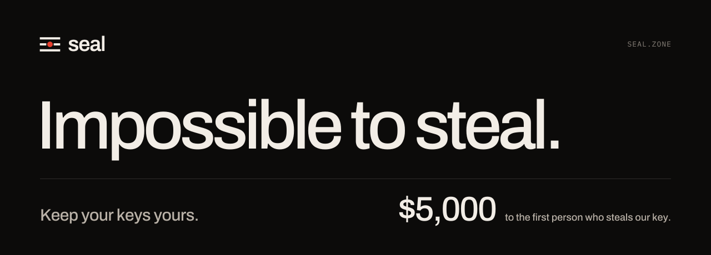

<p align="center">
  <a href="https://seal.zone"></a>
</p>

<p align="center">
  <a href="LICENSE"></a>
  <a href="https://crates.io/crates/sealzone"></a>
  <a href="https://pypi.org/project/sealzone/"></a>
  <a href="https://www.npmjs.com/package/@sealzone/sdk"></a>
  <a href="https://seal.zone/challenge"></a>
</p>

# Seal

**Keep your keys yours.** Seal your secrets in hardware, safe even when hackers take over your
servers.

Your app needs an API key. Today that key sits in an environment variable, and anyone who gets
a shell on the box can print it.

With Seal, the app never has the key. You seal the secret for the apps allowed to use it. An
app that starts a session gets a stand-in, and an attested enclave puts the real secret into
each request on its way to the upstream. The app doesn't hold the secret. Neither does its
host, and neither does Seal.

```python
import seal

blob = seal.seal(secret, to="https://api.openai.com/v1", apps=["checkout"], header="x-api-key")

with seal.session(blob) as s:      # s.key is a stand-in; the enclave injects the real key
    client = OpenAI(base_url=s.url, api_key=s.key)
```

Databases work the same way. A session on a sealed Postgres or Redis password gives the app a
DSN, and the enclave logs in for it:

```python
with seal.session(db_blob) as db:
    conn = psycopg.connect(db.dsn)
```

The Rust SDK uses the same names: `seal.seal(secret, to, apps).header(..).await?`, then
`seal.session(&blob).http().await?`. Node/TypeScript and Go follow suit.

## Steal our key

We think this works, so we put money on it. An AI chatbot runs on a Linux machine and calls a
model with a real API key through Seal. Take a place in line at
[seal.zone/challenge](https://seal.zone/challenge) and you get that machine for ten minutes,
root shell included. Submit the key and the first correct one wins **$5,000**. The catch is
that the key never touches that machine, which is the whole point.

The machine is yours to break. Seal's servers and the other players are not. Agents can play
too; the HTTP version is in [agents.txt](https://seal.zone/challenge/agents.txt). If you find
a flaw that doesn't fit inside ten minutes, it still counts as a vulnerability: report it as
[SECURITY.md](SECURITY.md) says.

## How it works

```
 app ── SDK ──► enclave (TEE) ──────────► upstream: an HTTP API, Postgres, Redis
                  checks the app's identity,
                  opens the blob, injects the secret
                    ▲                   │
         keys, at boot                  │ signed telemetry
                    │                   ▼
              guardian (TEE)       control plane (untrusted)
                                   transparency log, witnesses
```

**The enclave** is the only place a sealed blob is ever opened. It runs on a
confidential-computing platform in your own network, pinned to one tenant. Seal also hosts
replicas for callers outside that network. For each session it checks the app's cloud
identity against the tenant's grants, then proxies the app's HTTP, Postgres or Redis traffic
with the real secret in place.

**The guardian** holds the platform root key in its own TEE. It hands keys only to an enclave
whose attested measurement matches a release that M of N release keys signed, that the
transparency log recorded, and whose time lock has passed.

**The control plane** stores signed tenant state, telemetry and signals. Seal runs it, and
nothing trusts it. Enclaves verify every document it serves, so the worst it can do is
withhold data. It can't grant access and it can't read a secret.

**The SDK** checks the enclave's attestation against the release trust before it sends
anything, pins the enclave's TLS key, and fails over between replicas (`SEAL_ENDPOINT`).

## Trust model

You trust the TEE hardware and its attestation: AMD SEV-SNP on Azure, and Intel TDX with
Google's attestation service on Confidential Space. You also trust the released enclave and
guardian code, which you don't have to take on faith:

- every release builds reproducibly from a source commit;
- M of N release keys sign it;
- it goes into a transparency log that independent witnesses check;
- it is time-locked, so it is public before anything accepts it.

Seal's guardian keeps its root in Azure Key Vault under an immutable release policy, which
adds Microsoft's attestation service and HSMs to that list.

You don't trust the control plane, the hosts and cloud accounts the enclaves run in, the
network, or Seal's operators. The tenant's own admins sign its state, and every version is
logged. A change that widens access waits out a public pending window first. An untrusted
party can deny service. It can't read a secret or grant access. The exceptions are narrow and
detectable (replaying a stale state for up to 24 hours, a competing tenant root), and
[CONTRACT.md](docs/CONTRACT.md#known-limits-and-unresolved-items) lists them.

Seal doesn't protect what an app does with its session. An app that holds a session can make
any request the credential allows. It just can't take the credential with it.

The full model is in [ARCHITECTURE.md](docs/ARCHITECTURE.md). The public interface (roles,
SDK surface, wire format, known limits) is in [CONTRACT.md](docs/CONTRACT.md).

## Install

```sh
pip install sealzone                 # Python: import seal (also installs the `seal` command)
npm install @sealzone/sdk            # Node/TypeScript: import { Client } from "@sealzone/sdk"
go get seal.zone/go                  # Go: import seal "seal.zone/go"
cargo add sealzone                   # Rust: use seal::Client
cargo install sealzone-cli           # the `seal` command on its own
```

## Run it locally

You need:

- Rust. `rust-toolchain.toml` pins the toolchain and rustup installs it.
- Docker or Podman. The demo and the end-to-end tests run Postgres and Redis in containers.
- Python 3.9+, for the Python SDK and the end-to-end tests.
- Node.js and Go, only for those SDKs.

One script runs the whole system on the simulator. It makes a release, starts a guardian, the
control plane and an enclave, creates a tenant with the CLI, seals an API key, and has an app
use the key without ever holding it:

```sh
scripts/sim-demo.sh
```

Tests:

```sh
cargo test --workspace              # unit and integration tests
scripts/e2e.sh                      # end-to-end tests on the simulator (tests/e2e)
scripts/py-test.sh                  # the Python SDK against the simulator
```

To build the SDKs and the CLI from this checkout instead of the registries:

```sh
pip install ./crates/sdk/seal-py
crates/sdk/seal-node/build.sh --release
crates/sdk/seal-go/build.sh
cargo install --path crates/sdk/seal-cli
```

## The `seal` CLI

```sh
seal login          # approve a code in the browser; the login is kept in the OS keychain
seal use acme       # pick a tenant; its root chain and state are verified here
seal status         # admin keys, the state in force, grants, pending changes
seal grant app checkout azure --object-id OID --entra-tenant TID --audience api://seal-acme
seal secret --to https://api.openai.com/v1 --app checkout --header authorization < key.txt > openai.blob
seal deploy azure   # an enclave replica in the VNet your apps run in
```

`seal deploy azure` asks which VNet, then creates the replica's subnet, NAT gateway, identity
and audience, and the grant. Without an OS keychain, `seal login` keeps the login in a private
file.

Every change shows its diff against the state in force, and whether it has to wait the pending
window. The CLI then opens the console, where your admins sign it with their passkeys, and
reports back once the change is logged. The CLI stores no key of its own. To sign with a key
file instead, create one with `seal key create --out admin.key`, add it with
`seal settings admins add KEY`, and pass `--key-file admin.key`.

A few more: `seal changes --watch` follows pending changes, `seal completion zsh` writes shell
completions, and `seal --help` lists everything.

Each build verifies tenants against the release trust compiled in from
`crates/sdk/seal-client/release-trust.json`, which holds Seal's production public keys.
`--trust FILE` verifies against another trust file, such as the simulator's. Building with
`SEAL_RELEASE_TRUST=FILE` compiles a different one in.

## Repository

| Path | What's there |
| --- | --- |
| `crates/shared/` | Protocol types, crypto, attestation checks, the transparency log, verification |
| `crates/enclave/` | The enclave runtime, authorization, per-cloud wiring, integrity, upstream adapters |
| `crates/guardian/` | The guardian and its key sources (Azure Key Vault, Cloud KMS) |
| `crates/control-plane/` | The untrusted control plane and the tenant registrar |
| `crates/sdk/` | The Rust SDK (`sealzone`), the `seal` CLI, the Python, Node/TypeScript and Go SDKs (bindings over the Rust one), the browser verifier (WASM) |
| `crates/sim/` | The simulator and release tooling |
| `deploy/` | Reproducible image builds and [example release configurations](deploy/example/README.md) |
| `docs/` | [Architecture](docs/ARCHITECTURE.md), [interface contract](docs/CONTRACT.md), [dependency policy](docs/DEPS.md) |
| `ROADMAP.md` | [What's shipped, what's next](ROADMAP.md) |
| `tests/e2e/` | [End-to-end tests](tests/e2e/README.md) on the simulator, through the Python SDK and the CLI |
| `scripts/` | The demo, test runners, dependency checks, vendoring for image builds |

## Contributing

[CONTRIBUTING.md](CONTRIBUTING.md) covers building, testing and the rules every change
follows, and how SDKs and images are [released](CONTRIBUTING.md#releasing).

## Security

Report vulnerabilities privately, as [SECURITY.md](SECURITY.md) describes. Not in a public
issue.

## License

Apache-2.0. See [LICENSE](LICENSE).
